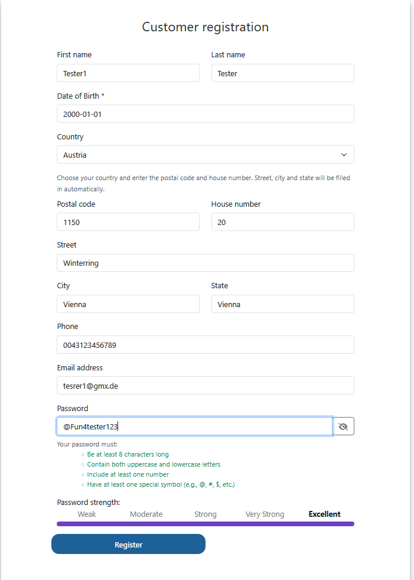
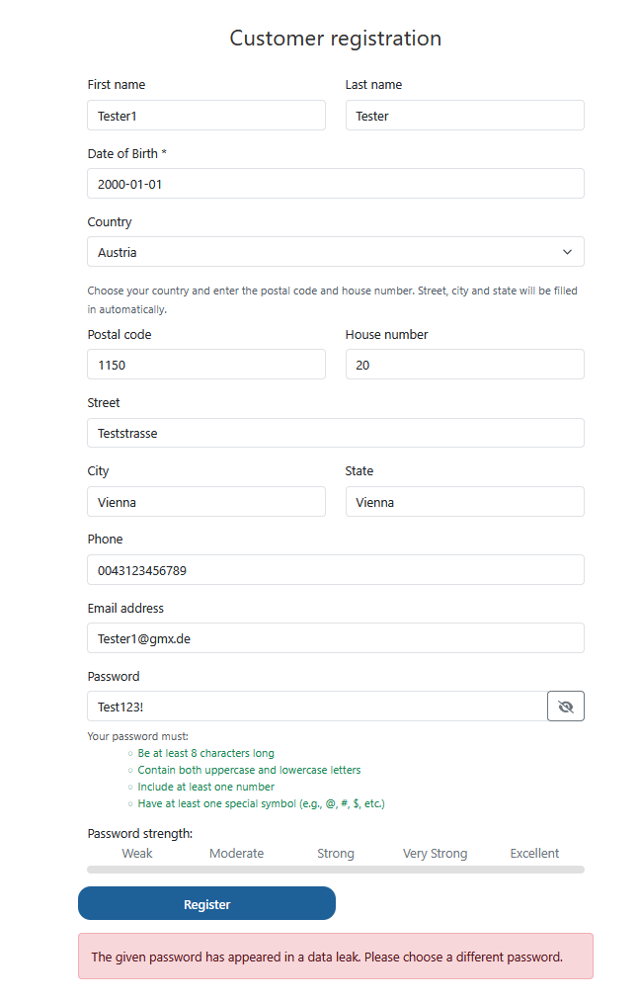
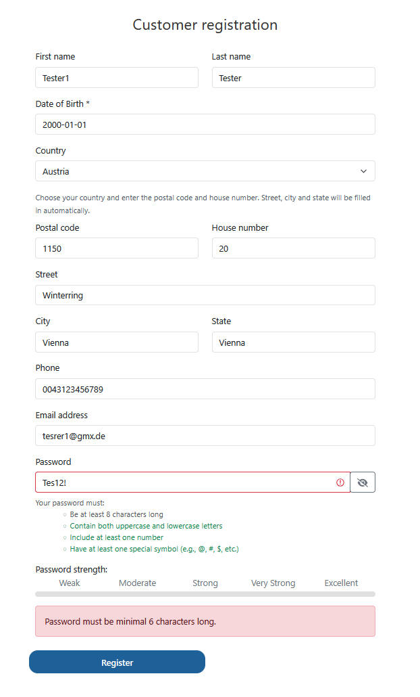
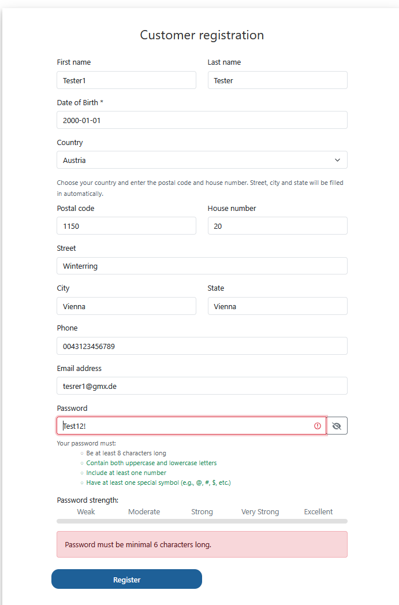
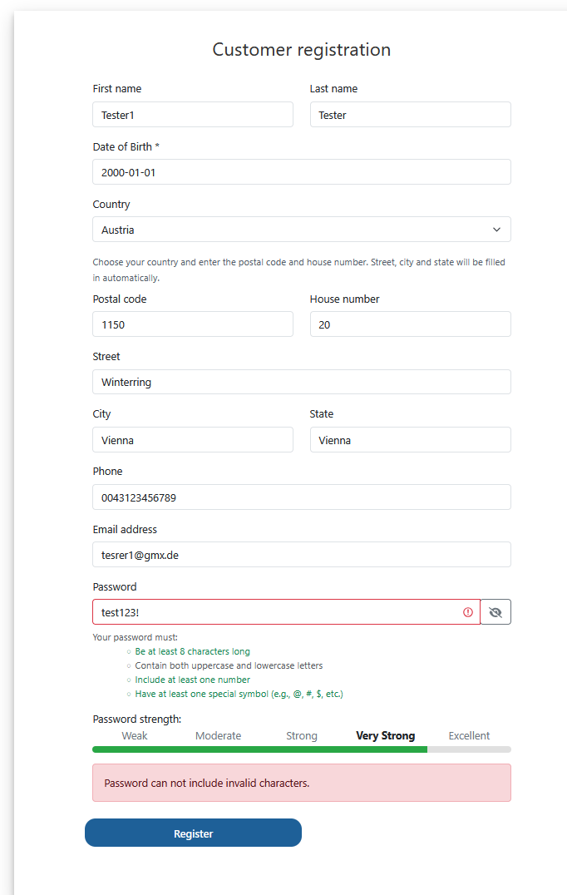
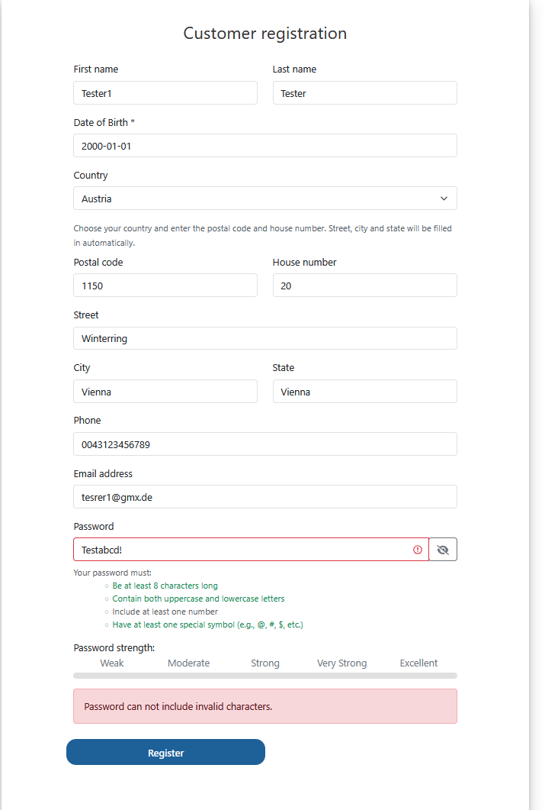
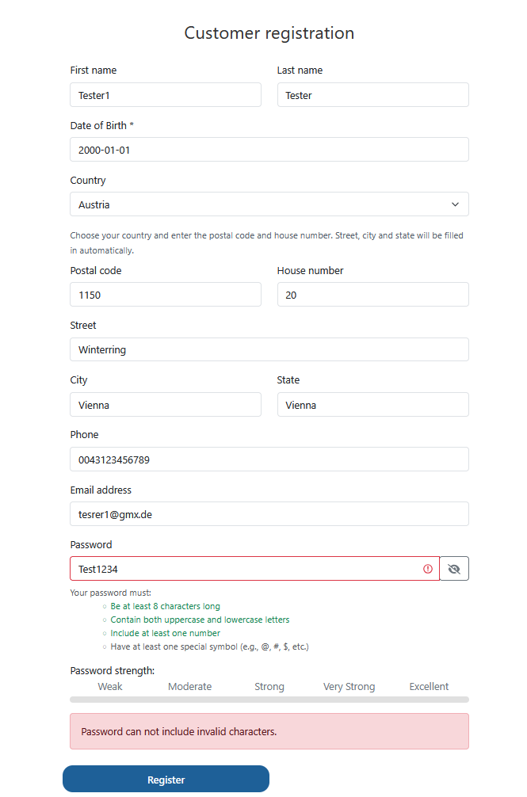
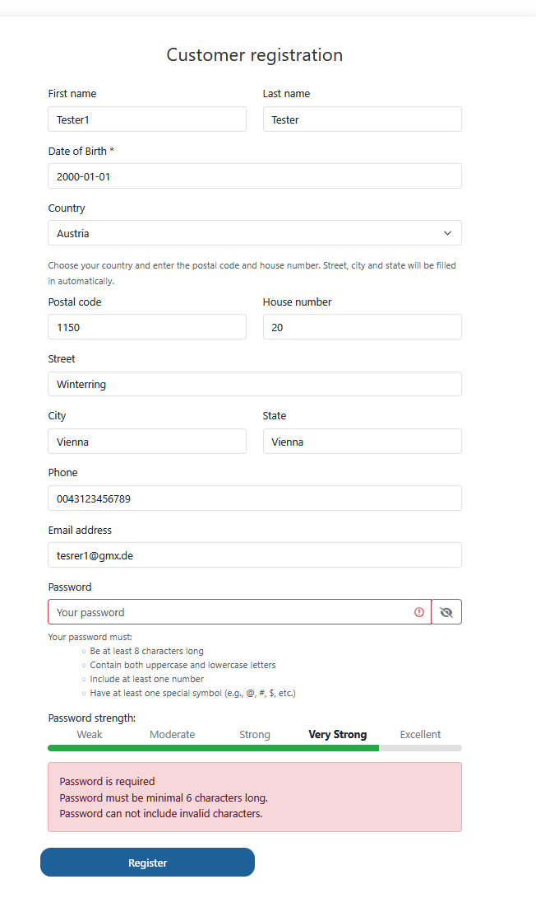
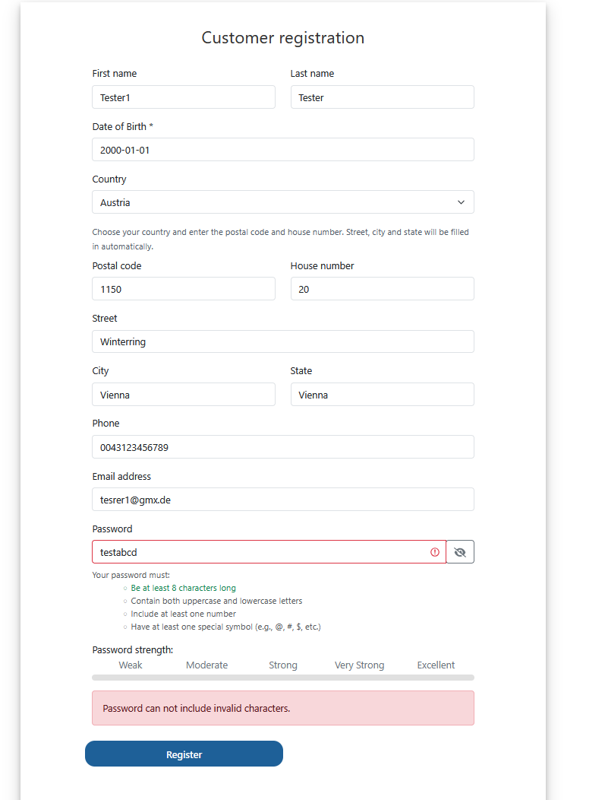

# Apply Decision Table Testing on Toolshop – Password Validation

## Reference to ISTQB Syllabus Chapter

ISTQB FL – 4.2.3 Decision Table Testing

## Link to the Transfer Task File

[Apply Decision Table Testing on Toolshop](https://github.com/JulietaTz/RBI-AgileEngineeringFoundation/blob/main/courses/TestBusters-LearningLab/ISTQB-2026/foundationLevel/transferTasks/Chapter%204/ISTQB-FL-4.2.3_Decision_Table_Testing_20260405.md)

**Trello Task:** J121

## Outcome

### 1. Test Objective

### 1. Test Objective

The goal of this task was to apply Decision Table Testing
(ISTQB FL 4.2.3) to a different feature in Toolshop.

The original transfer task focuses on delivery costs.
Since another team member had already completed this
example, I decided to apply the same test technique
to password validation in Customer Registration.

I wanted to check how different password conditions
affect the registration process.

I created a decision table, derived test cases and
executed them in Toolshop.

During testing, I also discovered an additional password
security check and identified three observations related
to validation messages.

**Application:** https://practicesoftwaretesting.com/

**Test area:** Customer Registration – Password Validation

**Test technique:** Decision Table Testing

**Test level:** System Testing

**Test type:** Functional Testing

**Browser:** Firefox Desktop

**Application version:** Toolshop v2.5

**Test date:** 29.10.2026

**Trello Task:** J121

**Test status:** Completed

---

### 2. Requirements

The registration form displays four password requirements:

1. At least 8 characters.
2. Uppercase and lowercase letters.
3. At least one number.
4. At least one special character.

During testing, I discovered an additional rule:

5. Passwords found in known data leaks are rejected.

I added this condition to my decision table after observing the application behavior.

For all tests, I used valid data in the other required registration fields.

---

### 3. Test Conditions

I identified five conditions.

| ID | Condition |
|---|---|
| C1 | Password contains at least 8 characters |
| C2 | Password contains uppercase and lowercase letters |
| C3 | Password contains at least one number |
| C4 | Password contains at least one special character |
| C5 | Password is found in a known data leak |

Each condition has two possible values: Yes or No.

Five conditions give 32 theoretical combinations.

I created a simplified decision table with six rules.

The data leak check is relevant when all four password format requirements are met.

---

### 4. Decision Table

| Conditions / Actions | R1 | R2 | R3 | R4 | R5 | R6 |
|---|---|---|---|---|---|---|
| C1: At least 8 characters | Y | N | Y | Y | Y | Y |
| C2: Uppercase and lowercase | Y | - | N | Y | Y | Y |
| C3: At least one number | Y | - | - | N | Y | Y |
| C4: At least one special character | Y | - | - | - | N | Y |
| C5: Found in data leak | N | - | - | - | - | Y |
| **Password accepted** | X | - | - | - | - | - |
| **Password rejected** | - | X | X | X | X | X |

**Legend:**

- Y = Yes
- N = No
- "-" = Don't care
- X = Expected action

**Rules:**

- R1: All password requirements are met, and the password is not reported as leaked.
- R2: Password is too short.
- R3: Uppercase or lowercase letter is missing.
- R4: Number is missing.
- R5: Special character is missing.
- R6: Password meets all format requirements but is reported as leaked.

The rules use don't-care values to reduce the number of combinations.

---

### 5. Derived Test Cases

| Test Case | Rule | Test Data | Expected Result |
|---|---|---|---|
| TC-01 | R1 | Valid new password | Registration successful |
| TC-01b | R6 | Test123! | Leaked password rejected |
| TC-02 | R2 | Te1! | Password rejected |
| TC-03 | R3 | test123! | Password rejected |
| TC-04 | R4 | Testabcd! | Password rejected |
| TC-05 | R5 | Test1234 | Password rejected |

I also performed additional tests:

| Test Case | Test Data | Expected Result |
|---|---|---|
| TC-02a | Tes12! | 6-character password rejected |
| TC-02b | Test12! | 7-character password rejected |
| TC-06 | Empty password | Registration rejected |
| TC-07 | testabcd | Multiple invalid conditions rejected |

---

### 6. Test Execution

**Preconditions:**

- Toolshop is accessible.
- Customer Registration is open.
- All other required fields contain valid test data.
- A new email address is used for successful registration.

**Test Steps:**

1. Open Toolshop.
2. Click "Sign in".
3. Click "Register your account".
4. Enter valid data in all required fields.
5. Enter the test password.
6. Check the password validation.
7. Click "Register".
8. Compare the actual result with the expected result.
9. Save screenshots.

---

### 7. Test Execution Results

#### TC-01 – Valid Password / Successful Registration

**Expected Result:**

Registration is successful when all password requirements are met.

**Actual Result:**

All four password requirements were displayed in green.

The password strength indicator showed "Excellent".

After clicking "Register", I was redirected to the Login page.

I logged in with the newly created account.

The "My account" page opened successfully.

**Status: PASS**

**Test Evidence:**

---

#### TC-01b – Password Found in Data Leak

**Test Password:** `Test123!`

**Expected Result:**

A password reported as leaked should be rejected.

**Actual Result:**

All four password format requirements were met.

After clicking "Register", the application displayed:

"The given password has appeared in a data leak. Please choose a different password."

Registration was rejected.

**Status: PASS**

**Observation:**

I discovered an additional security check that was not included in my original decision table.

**Test Evidence:**

---

#### TC-02 – Password Too Short

**Test Password:** `Te1!`

**Expected Result:**

Registration is rejected because the password has fewer than 8 characters.

**Actual Result:**

Registration was rejected.

Error message:

"Password must be minimal 6 characters long."

**Status: PASS**

**Observation:**

The registration form requires 8 characters, but the error message mentions 6 characters.

---

#### TC-02a – Password With 6 Characters

**Test Password:** `Tes12!`

**Expected Result:**

Registration is rejected because the password has fewer than 8 characters.

**Actual Result:**

Registration was rejected.

Error message:

"Password must be minimal 6 characters long."

**Status: PASS**

**Test Evidence:**

---

#### TC-02b – Password With 7 Characters

**Test Password:** `Test12!`

**Expected Result:**

Registration is rejected because the password has fewer than 8 characters.

**Actual Result:**

Registration was rejected.

Error message:

"Password must be minimal 6 characters long."

**Status: PASS**

**Observation:**

Passwords with 6 and 7 characters were rejected.

The error message does not match the visible requirement.

**Test Evidence:**

---

#### TC-03 – Missing Uppercase Letter

**Test Password:** `test123!`

**Expected Result:**

Registration is rejected because an uppercase letter is missing.

**Actual Result:**

Registration was rejected.

Error message:

"Password can not include invalid characters."

**Status: PASS**

**Observation:**

The message does not clearly explain that an uppercase letter is missing.

**Test Evidence:**

---

#### TC-04 – Missing Number

**Test Password:** `Testabcd!`

**Expected Result:**

Registration is rejected because a number is missing.

**Actual Result:**

Registration was rejected.

Error message:

"Password can not include invalid characters."

**Status: PASS**

**Observation:**

The message does not explain that a number is missing.

**Test Evidence:**

---

#### TC-05 – Missing Special Character

**Test Password:** `Test1234`

**Expected Result:**

Registration is rejected because a special character is missing.

**Actual Result:**

Registration was rejected.

Error message:

"Password can not include invalid characters."

**Status: PASS**

**Observation:**

The message does not explain that a special character is missing.

**Test Evidence:**

---

#### TC-06 – Empty Password

**Test Password:** Empty

**Expected Result:**

Registration is rejected because a password is required.

**Actual Result:**

Registration was rejected.

Three error messages appeared:

- "Password is required"
- "Password must be minimal 6 characters long."
- "Password can not include invalid characters."

**Status: PASS**

**Observation:**

The application correctly rejected the empty password, but the additional messages may confuse users.

**Test Evidence:**

---

#### TC-07 – Multiple Password Requirements Not Met

**Test Password:** `testabcd`

**Expected Result:**

Registration is rejected because the password does not contain:

- An uppercase letter
- A number
- A special character

**Actual Result:**

Registration was rejected.

Error message:

"Password can not include invalid characters."

**Status: PASS**

**Observation:**

The password was rejected, but the error message did not explain which requirements were missing.

**Test Evidence:**

---

### 8. Test Results Summary

| Test Case | Expected Result | Actual Result | Status |
|---|---|---|---|
| TC-01 | Registration successful | Registration and login successful | PASS |
| TC-01b | Leaked password rejected | Rejected | PASS |
| TC-02 | Short password rejected | Rejected | PASS |
| TC-02a | 6-character password rejected | Rejected | PASS |
| TC-02b | 7-character password rejected | Rejected | PASS |
| TC-03 | Missing uppercase rejected | Rejected | PASS |
| TC-04 | Missing number rejected | Rejected | PASS |
| TC-05 | Missing special character rejected | Rejected | PASS |
| TC-06 | Empty password rejected | Rejected | PASS |
| TC-07 | Multiple invalid conditions rejected | Rejected | PASS |

**Total tests executed:** 10

**Passed:** 10

**Failed:** 0

**Blocked:** 0

**Not executed:** 0

All tests passed regarding the expected password acceptance or rejection.

Some validation messages were unclear or inconsistent.

---

### 9. Defects and Observations

I identified three observations during testing.

| ID | Related Tests | Observation | Proposed Severity |
|---|---|---|---|
| OBS-01 | TC-02, TC-02a, TC-02b | The form requires 8 characters, but the error message says 6 characters. | Low |
| OBS-02 | TC-03, TC-04, TC-05, TC-07 | The error message does not clearly explain the missing password requirement. | Low |
| OBS-03 | TC-06 | An empty password displays three validation messages. | Low |

#### OBS-01 – Inconsistent Password Length Message

The password requirements say:

"Be at least 8 characters long."

However, the error message says:

"Password must be minimal 6 characters long."

Passwords with fewer than 8 characters were rejected in the executed tests.

The error message should be updated to match the displayed requirement.

#### OBS-02 – Unclear Password Validation Message

Different invalid passwords produced the same message:

"Password can not include invalid characters."

The message does not clearly tell the user what is wrong.

More specific validation messages would help users correct their passwords.

#### OBS-03 – Multiple Messages for Empty Password

An empty password displayed three error messages.

The message "Password is required" is correct.

The other messages may be unnecessary or confusing.

These observations should be reviewed before they are classified as confirmed defects.

---

### 10. Test Evidence

I saved screenshots during test execution.

**Evidence folder:**

`transferTasks-Outcome/images/FL_J21/`

| Test Case | Evidence |
|---|---|
| TC-01 | [Valid Password](images/FL_J121/TC-01.png) |
| TC-01b | [Leaked Password](images/FL_J121/TC_01b.png) |
| TC-02a | [6 Characters](images/FL_J121/TC_02a.png) |
| TC-02b | [7 Characters](images/FL_J121/TC_02b.png) |
| TC-03 | [Missing Uppercase](images/FL_J121/TC_03.png) |
| TC-04 | [Missing Number](images/FL_J121/TC-04.png) |
| TC-05 | [Missing Special Character](images/FL_J121/TC-05.png) |
| TC-06 | [Empty Password](images/FL_J121/TC-06.png) |
| TC-07 | [Multiple Invalid Conditions](images/FL_J121/TC-07.png) |

The screenshots show the password inputs, validation messages and results.

The successful registration was also checked by logging into the new account.

---

### 11. Learning Summary

| Concept | What I Learned |
|---|---|
| Decision Table Testing | I learned how to test combinations of conditions and results. |
| Test Conditions | I identified password rules and used them as conditions. |
| Decision Rules | I created rules for valid and invalid passwords. |
| Test Cases | I derived test cases from the decision table. |
| Don't-care Values | I used don't-care values to simplify the table. |
| Test Coverage | I tested both valid and invalid password conditions. |
| Additional Business Rules | I discovered a data leak check during testing. |
| Defect Identification | I identified unclear and inconsistent error messages. |
| Test Documentation | I documented test results and saved screenshots as evidence. |

### 12. Conclusion

In this task, I applied Decision Table Testing to the password validation in the Toolshop Customer Registration form.

I started with four password conditions and created test cases based on these requirements.

During testing, I discovered an additional condition: the application checks whether passwords have appeared in known data leaks.

I updated my decision table to include this rule.

I executed 10 test cases, including additional tests for password length.

All 10 tests passed regarding password acceptance or rejection.

I also identified three observations related to unclear or inconsistent validation messages.

The most important observation was the difference between the required minimum password length of 8 characters and the error message mentioning 6 characters.

This task helped me understand how to create a decision table, derive test cases and discover additional rules during testing.

---

## References

- ISTQB CTFL 4.0 – Section 4.2.3 Decision Table Testing
- Toolshop: https://practicesoftwaretesting.com/
- Toolshop Documentation: https://github.com/testsmith-io/practice-software-testing/tree/main/docs
